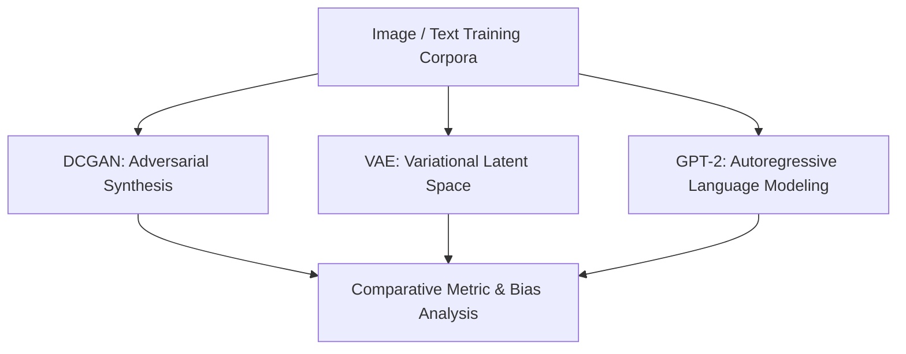

<p align="center">
  
</p>

<p align="center">
    
</p>


## 📌 Table of Contents
- [📖 Executive Summary](#-executive-summary)
- [✨ Key Features & Capabilities](#-key-features--capabilities)
- [🏗️ System Architecture & Workflow](#️-system-architecture--workflow)
- [🛠️ Tech Stack Breakdown](#️-tech-stack-breakdown)
- [⚙️ Reproducible Quickstart & Setup](#️-reproducible-quickstart--setup)
- [📂 Project Directory Layout](#-project-directory-layout)
- [👩‍💻 Author & Contributions](#-author--contributions)

---

## 📖 Executive Summary
### Problem Statement
Generative AI encompasses diverse paradigms from latent probability estimation (VAEs) and adversarial games (GANs) to autoregressive transformer pretraining.

### Motivation & Solution Overview
A comprehensive, 12-assignment laboratory suite implementing DCGAN image synthesis, Variational Autoencoders (VAEs), GPT-2 fine-tuning on text corpora, and algorithmic bias audits.

---

## ✨ Key Features & Capabilities
- **GAN vs VAE Comparative Analysis:** Empirical benchmark comparing generative fidelity vs latent continuity.
- **Transformer Fine-Tuning:** Hugging Face transformer fine-tuning for specialized sequence generation.
- **Adversarial Image Synthesis:** Deep Convolutional GAN trained on Fashion-MNIST.
- **Bias Mitigation:** Auditing dataset distributions to identify and reduce demographic bias in generative pipelines.

---

## 🏗️ System Architecture & Workflow


---

## 🛠️ Tech Stack Breakdown
| Category | Technologies |
|---|---|
| **Frameworks** | PyTorch, Hugging Face Transformers, Torchvision |
| **Techniques** | DCGAN, VAE, Fine-Tuning, Latent Space Interpolation |
| **Environment** | Jupyter Notebook, Python 3.10 |

---

## ⚙️ Reproducible Quickstart & Setup
### How to Explore
```bash
git clone https://github.com/Bhumikaravi/Generative-AI.git
cd Generative-AI
pip install torch torchvision transformers datasets jupyter
jupyter notebook
```

---

## 📂 Project Directory Layout
```text
Generative-AI/
├── Assignment_10_GAN_vs_VAE (2).ipynb
├── Assignment_11_GPT2_Fine_Tuning (2).ipynb
├── Assignment_1_GEN_AI.ipynb
├── Assignment_3___AI_Bias.ipynb
├── Assignment_4_DCGAN_Fashion_MNIST.ipynb
└── README.md
```

---

## 👩‍💻 Author & Contributions
Developed by **Bhumika Ravi** ([@Bhumikaravi](https://github.com/Bhumikaravi)), Bachelor of Computer Applications (BCA) at **Alliance University, Bengaluru**.

- 💻 **GitHub Profile:** [github.com/Bhumikaravi](https://github.com/Bhumikaravi)
- 🔗 **LinkedIn:** [linkedin.com/in/bhumika-ravi-b5a01b326](https://www.linkedin.com/in/bhumika-ravi-b5a01b326/)
- 📬 **Email Contact:** [bhumikaravi2006@gmail.com](mailto:bhumikaravi2006@gmail.com)

---

<p align="center">
  
</p>
